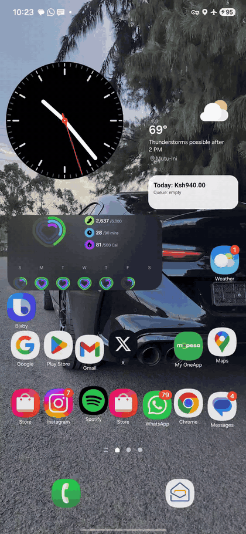
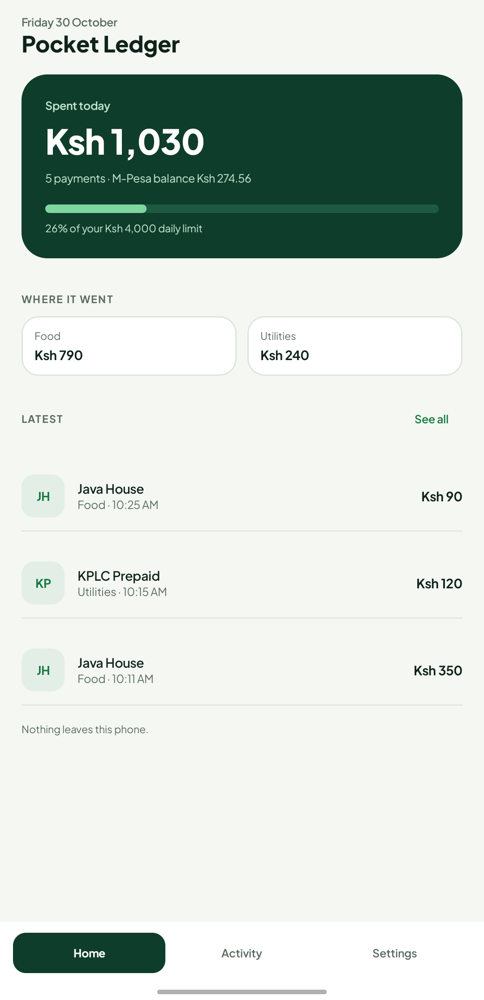
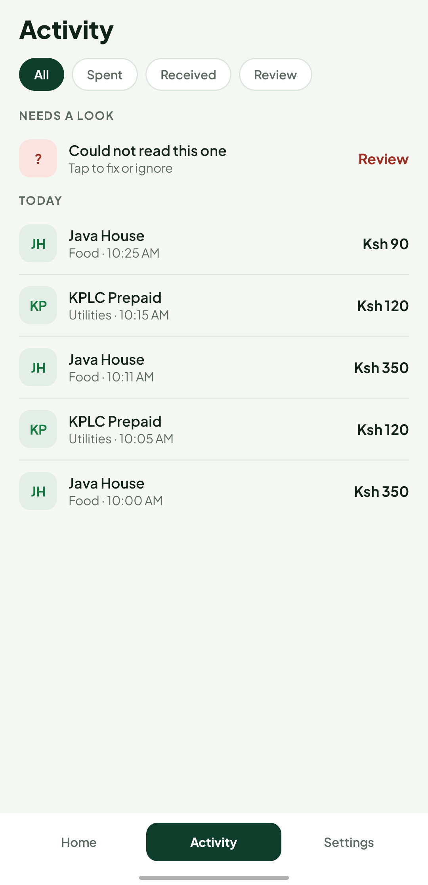
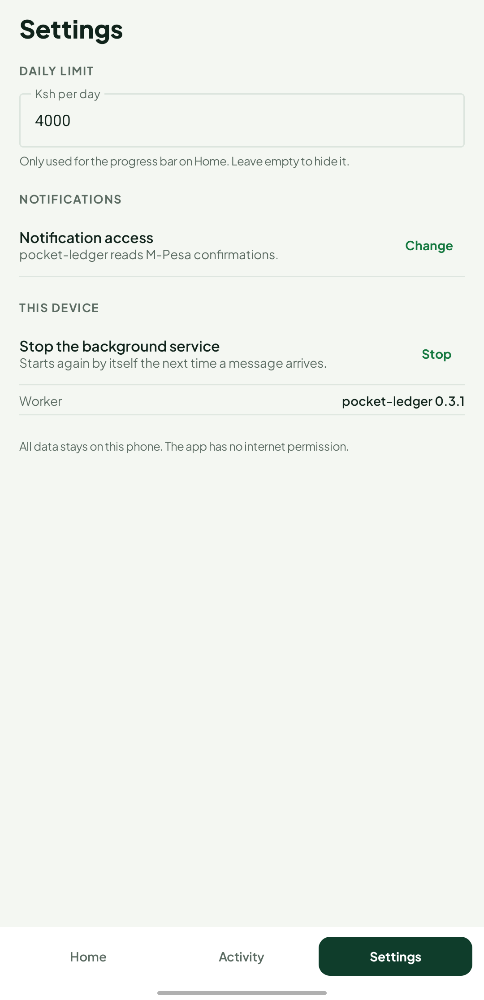

# pocket-ledger

> Rivium + Apalis pocket backend challenge entry: an offline-first M-Pesa auto-ledger.

**Install:** [unccllin.github.io/pocket-ledger](https://unccllin.github.io/pocket-ledger/) — one
download button, the exact steps past Play Protect, and a QR for phones. The APK itself is
on [Releases](https://github.com/Unccllin/pocket-ledger/releases/latest).

M-Pesa confirmation notifications are captured by an Android Notification Listener,
queued as Apalis jobs, parsed by a Rust worker running under Rivium inside the app,
stored in SQLite, and surfaced on a home screen widget plus a result notification.

Everything stays on the phone. The app has no `INTERNET` permission at all.

## What it does

1. `MpesaListener` (a `NotificationListenerService`) sees incoming notifications and
   keeps only M-Pesa-shaped confirmations (a 10-character transaction code plus
   "Confirmed").
2. Each one is enqueued as the single Apalis job type
   `ParseTransaction { raw_text, received_at }`, persisted in SQLite, keyed by the
   M-Pesa transaction code.
3. A Rust worker running under Rivium parses it, categorises it, and stores one row
   in the `ledger` table.
4. The phone shows the result: **Home** (today's total, a daily-limit bar, the top
   three categories and the latest rows), **Activity** (everything, grouped by day,
   with waiting and needs-review states), two home screen widgets, and a result
   notification such as `Spent Ksh 350 at Java House` / `Food · 53% of daily limit used`.

One job type, no scope creep. The test button in Settings is a debug aid; the real
trigger is an incoming notification.

## Demo



Recorded on the real phone in **airplane mode**: an M-Pesa confirmation arrives while the
app is closed and the home screen widget goes from `Ksh940.00` to `Ksh1,030.00` without the
app ever being opened; the app is then force-stopped and reopened with all five ledger rows
still in place. The GIF's notification shade is deliberately trimmed: it contained the
phone owner's personal notifications, which do not belong in a repository.

## Install on your phone

pocket-ledger is sideloaded from a signed APK - there is no Play listing, which suits an
app with no account and no `INTERNET` permission.

- Open the [install page](https://unccllin.github.io/pocket-ledger/) (or the
  [Releases](https://github.com/Unccllin/pocket-ledger/releases/latest) page) and
  download the latest APK (Android 8.0+, arm64 phone; the same file also carries an
  `x86_64` build for emulators, ~29.5 MB).
- Tap it, allow installs from your file manager, install, then allow Notification Access
  on the first screen.
- Check `SHA256SUMS.txt` from the release page if you want to verify the download; the
  signing certificate digest is published in [`docs/INSTALL.md`](docs/INSTALL.md) and
  stays the same across releases.

The laptop worker is also published as a container image on GitHub Packages
(`ghcr.io/unccllin/pocket-ledger`, tags `latest` and `X.Y.Z`), built on every push
to master and on tags:

```sh
docker run --rm -v "$PWD/ledger-data:/data" \
  ghcr.io/unccllin/pocket-ledger:latest --root /data ingest \
  "SJA1B2C3D4 Confirmed. Ksh500.00 sent to JOHN DOE on 5/10/26 at 2:15 PM. New M-PESA balance is Ksh1,234.56."
docker run --rm -v "$PWD/ledger-data:/data" \
  ghcr.io/unccllin/pocket-ledger:latest --root /data stats
```

Build a signed APK yourself with `scripts/release.sh` (it creates the key once, outside
the repo, at `~/.pocketledger/release.jks` and prints its fingerprint). Maintainers
publish by pushing a `v*` tag: `.github/workflows/release.yml` builds both Rust ABIs,
signs the APK with the repository's signing secrets and attaches it plus checksums to
the GitHub Release. Without those secrets the workflow still produces an unsigned
artifact and skips the release.

## Architecture

```text
notification ──► MpesaListener (Kotlin, NotificationListenerService)
                     │  shape check in Kotlin, then JNI
                     ▼
                 Bridge.nativeEnqueue ──► ledger-jni (Rust cdylib)
                                             │ Apalis queue row (SQLite)
                                             ▼
                 Rivium service ──► ledger-worker (Rust)
                     │  ParseTransaction job
                     ▼
                 ledger-core parser + categoriser ──► ledger row
                     │
                     ├──► MpesaText polls stats ──► result notification
                     └──► LedgerWidget ──► widget refresh (today's spend, queue)
```

```text
crates/
  ledger-core/     pure Rust: parser, categoriser, domain types (zero dependencies)
  ledger-worker/   Apalis worker + SQLite ledger + Rivium App + laptop CLI
  ledger-jni/      cdylib: Rivium's five-method ABI + nativeEnqueue/nativeStats
android/           Kotlin app: Compose UI (Home, Activity, Settings), listener,
                   two widgets, result notification, JNI bridge
docs/              DEVICE_TEST.md
```

## Design

The UI follows [`docs/DESIGN.md`](docs/DESIGN.md): tokens, type, spacing, per-screen
layout, states and copy. One light theme: ground `#F4F7F2`, a forest `#0F3D2B` hero, mint
for the one progress bar, amber for "waiting" and red only for messages that need a
person. Type is **Plus Jakarta Sans**, bundled under `android/app/src/main/res/font/`
(SIL OFL, licence in `android/app/src/main/assets/licenses/`), so the app still never
downloads anything. No icons and no emoji anywhere: rows carry initials.

The app icon is the same idea as the hero card: a white M-Pesa confirmation slip with a
mint head and a torn bottom edge, on forest. It ships as an adaptive icon (with a
monochrome layer for Android 13 themed icons) plus raster fallbacks, and a matching
24dp white slip is the notification small icon, so the status bar no longer shows a
generic system glyph.


| Home | Activity | Settings |
|---|---|---|
|  |  |  |

Those three, plus `home-revoked.png`, `home-200.png` and `details.png`, were captured on
the **physical phone** (the status bar is cropped out: it carried the owner's own
notifications). The states that are hard to stage on someone's daily driver were captured
on the Android 16 emulator instead: the first-run explainer and its granted state, the
empty Home, the review sheet, the notification shade and both widgets.

Also captured: `media/ui/home-empty.png`, `home-revoked.png`, `first-run.png`,
`first-run-granted.png`, `details.png`, `review.png`, `widgets.png` (forest "Spent today"
and surface "This week" on the launcher), `notifications.png` (grouped results) and
`home-200.png` (200% font scale; rows grow, amounts do not clip). `activity-waiting.png`
is the Activity screen with a message still reading, so the amber waiting row is visible
next to done and needs-review rows; it comes from the emulator, where a burst of messages
can be queued on demand.

How the pieces line up with the spec's build order:

| Spec step | Where |
|---|---|
| Tokens, type, theme | `ui/design/Color.kt`, `Type.kt`, `Theme.kt` |
| Shared components | `ui/components/` (hero, waiting strip, tiles, rows, chips, nav) |
| Home | `ui/screens/HomeScreen.kt` |
| Activity + review | `ui/screens/ActivityScreen.kt`, `Sheets.kt` |
| Result notification | `MpesaText.kt` |
| Widgets | `widget/Widgets.kt` + `res/layout/widget_*.xml` |
| Repository seam | `data/LedgerState.kt` (interface), `JniLedgerRepository`, `FakeLedgerRepository` |
| First run | `ui/screens/FirstRunScreen.kt` |
| Daily limit | `data/LedgerPrefs.kt` (Ksh 4,000 default, editable in Settings) |
| App icon | `drawable/ic_launcher_*` + `mipmap-*` |

## Run on laptop (no phone)

Requires Rust 1.94+ (the workspace pins `rust-version = "1.94"`; `sqlx 0.9` needs it; built here with 1.99.1).

```sh
# 1. Parse fixtures and enqueue them. The non-M-Pesa block is filtered out.
cargo run -p ledger-worker -- --root target/dev ingest-file \
  crates/ledger-core/tests/fixtures/mpesa_messages.txt

# 2. Inspect the queue (JSON).
cargo run -p ledger-worker -- --root target/dev stats

# 3. Run the worker under Rivium until Ctrl-C.
cargo run -p ledger-worker -- run --root target/dev

# 4. Check the ledger is complete and the queue is empty.
cargo run -p ledger-worker -- --root target/dev stats
```

`stats` output after processing the fixtures:

```json
{
  "ledger_rows": 6,
  "today_spend_cents": 0,
  "today_income_cents": 0,
  "queued_jobs": 0,
  "running_jobs": 0,
  "failed_jobs": 0,
  "unparsed": 0,
  "latest": [ { "code": "SJA3B4C5D6", "kind": "paybill",
                "category": "utilities", "amount_cents": 120000,
                "counterparty": "KPLC PREPAID", "occurred_at": 1791223200 } ]
}
```

`today_spend_cents` is `0` for the fixtures on purpose: they are dated `5/10/26`, and
the figure only counts transactions whose message timestamp falls inside today's
East Africa Time window. **Send a test message** in Diagnostics generates a message dated
today, so the widget moves.

`run` is a Rivium process host, so it also accepts `check-config`, `default-config`,
`--config FILE` and `--set key=value`. `--delay-ms N` is a laptop-only debug knob that
keeps a job in flight for the persistence scenario below.

### Tests

```sh
cargo test --workspace     # 67 tests: parser fixtures, dedup, retries, orphan recovery, aggregates
cargo clippy --workspace --all-targets -- -D warnings
cargo fmt --all --check
```

## Run on Android

Toolchain used (all pinned, see the table below): JDK 17, Android SDK platform 36,
build-tools 36.0.0, NDK 27.2.12479018, `cargo-ndk` 4.1.2, Gradle 8.14.6.

```sh
# 1. Cross-compile the Rust library into the app (arm64 phone + x86_64 emulator).
rustup target add aarch64-linux-android x86_64-linux-android
cargo ndk -t arm64-v8a -t x86_64 \
  -o android/app/src/main/jniLibs build -p ledger-jni --release

# 2. Build the APK.
cd android && ./gradlew assembleDebug

# 3. Install on a connected device.
adb install -r app/build/outputs/apk/debug/app-debug.apk
```

The Gradle build needs `android/local.properties` with `sdk.dir=/path/to/Android/Sdk`
(or `ANDROID_HOME` exported). `local.properties` is not committed.

In the app:

1. The first screen explains why Notification Access is needed; tap **Open notification
   access settings**, allow pocket-ledger, come back and tap **Continue**. (The first
   screen shows a "granted" state the moment the system setting changes.)
2. Add the two widgets: **Spent today** (forest, 2x2) and **This week** (surface, 2x2).
3. Watch confirmations land: Home and Activity update, both widgets redraw and the
   result notification appears without opening the app.

Screens: **Home** (date, title, forest hero with today's total and the daily-limit bar,
the amber waiting strip when jobs are queued, the top three categories, three latest
rows), **Activity** (All/Spent/Received/Review filters, day headings, and the three row
states: done, waiting, needs review) and **Settings** (daily limit, notification access,
the test message, stopping the service, worker version). Row taps open a details sheet
with the transaction code, the balance after, and the original message behind **Show
original** (phone numbers masked). A needs-review row opens the review sheet with
**Retry** and **Ignore**; nothing is ever deleted.

The screens read one `stats` call through `LedgerRepository`. Home refreshes every 2.5 s
while visible, Activity every 1 s (rows change state there); widgets never poll and never
start the service, they draw the last cached snapshot.

Granting Notification Access and sending a notification over adb, exactly as tested:

```sh
# needs the explicit user id, otherwise the command silently does nothing
adb shell cmd notification allow_listener com.pocketledger/com.pocketledger.MpesaListener 0

# quote the whole device command; without the single quotes the body is truncated
# and the listener (correctly) rejects it as not M-Pesa shaped. A code is exactly
# 2 letters + 8 alphanumerics and must contain a digit, so both the synthetic
# SJA1B2C3D4 (used in the device test) and a real-looking SJ41H2K9LM pass.
adb shell "cmd notification post -t 'M-PESA' mpesa 'SJA1B2C3D4 Confirmed. Ksh350.00 paid to JAVA HOUSE. on 5/10/26 at 1:00 PM. New M-PESA balance is Ksh684.56. Transaction cost, Ksh0.00.'"
```

Verified on a Samsung SM-A546U1 running Android 16; see `docs/DEVICE_TEST.md` for the
full log, including the bugs found on the way.

## How jobs survive app restarts

Jobs live in SQLite (`Jobs` table, Apalis) inside the app's private storage, so they
exist before any work starts and outlive the process. Two things make restarts safe:

1. **The transaction code is the idempotency key.** Enqueueing the same confirmation
   twice keeps exactly one queue row (`UNIQUE(job_type, idempotency_key)`), and the
   ledger insert is `INSERT ... ON CONFLICT(code) DO NOTHING`, so at-least-once
   execution still produces exactly one ledger row.
2. **Startup recovery re-queues interrupted work.** Apalis' own orphan recovery relies
   on a `Workers` heartbeat table that this backend never populates, so `kill -9` would
   leave jobs reserved forever. On start-up the service sets every `Running`/`Queued`
   job for this queue back to `Pending` (single worker per device is the documented
   assumption), then declares readiness.

Measured on this machine with the laptop binary (a `kill -9`, not a graceful stop):

```
# 6 fixtures enqueued, worker running with --delay-ms 3000
queued after ingest: 6
=== after kill -9 (4.2s into a 3s-per-job run) ===
{'ledger_rows': 2, 'queued_jobs': 6, 'running_jobs': 0, 'failed_jobs': 0, 'unparsed': 0}

# restart
worker ready: db=target/dev/ledger.db recovered_jobs=6 delay_ms=0
worker stopped
=== final state ===
{'ledger_rows': 6, 'queued_jobs': 0, 'running_jobs': 0, 'failed_jobs': 0, 'unparsed': 0}
distinct codes: (6, 6)          # 6 codes, 6 rows: nothing lost, nothing duplicated
job statuses: [('Done', 6)]
```

Three Rivium start/stop cycles on the same database also exit `0` with no leaked
tasks, and the ledger is unchanged between them.

### Malformed messages

A message that looks like M-Pesa but does not match a known shape is written to the
`unparsed` table on every attempt and returned as an error, so Apalis retries it a
bounded number of times (3) and then stops. It is never dropped silently and never
retried forever. Non-M-Pesa notifications are filtered in Kotlin before they reach the
native library, and again in Rust before a job is written.

## Privacy

No network calls anywhere: the app declares no `INTERNET` permission, the Rust crates
add no HTTP client, and all fixtures are synthetic. Phone numbers are stripped during
parsing and never stored; a stalled message keeps its raw text only in the local
`unparsed` table for review. The database lives in the app's private storage.

## Limitations (honest status)

- Fixtures are synthetic; the parser follows the message bodies they contain. Real
  M-Pesa wording varies slightly by release, and the fixture headers themselves had one
  internal disagreement (withdraw), which is documented rather than hidden in
  `crates/ledger-core/tests/fixtures.rs`. Transaction codes are accepted as two leading
  letters plus eight alphanumerics containing at least one digit (so `SJ41H2K9LM` and
  the synthetic `SJA1B2C3D4` both parse, while `WITHDRAWAL` does not).
- The message timestamp is interpreted as East Africa Time (UTC+3) because it has no
  zone in the text; messages from another zone would land on the wrong day.
- Startup recovery assumes one worker process per device. Running the laptop CLI
  against the same database file while the app runs is not supported.
- `today_spend_cents` counts amount plus transaction cost, excluding money received.
  It is a single-day figure, not a budget.
- The Android result notification is posted by Kotlin polling `stats` for up to 5
  seconds after enqueue, not by a native callback; a native completion callback is the
  obvious next step.
- The UI depends on AndroidX Compose (BOM `2026.05.01`, i.e. Compose 1.11.x) and
  `activity-compose` 1.12.4. Those are UI libraries only; the app still declares no
  `INTERNET` permission, so nothing can phone home even in principle.
- v1 is light-only. `docs/DESIGN.md` asks for that; a dark theme is under Future ideas.
- Widgets draw the cached snapshot, never the live service, and refresh when a message
  finishes (the listener triggers it). There is still no native completion event from
  Rivium to Kotlin, so "finished" means "the row is visible in `stats`".
- The daily limit is a local preference used for one progress bar; it is not a budget
  engine and the app never blocks a payment.
- The 0.3 screenshots were captured on an Android 16 x86_64 emulator. `docs/DEVICE_TEST.md`
  holds the separate physical-phone log, which predates the redesign.
- Release signing is local: the key lives at `~/.pocketledger/release.jks`, outside the
  repository, and CI reads it from secrets. Lose the key and you cannot ship an update
  that installs over the old app; keep a backup.
- No Play Store packaging (an `.aab`), no crash reporting, no update check: the app is
  deliberately inert without a network. Distribution is the signed APK plus this
  repository's release workflow.

## Future ideas

- Native completion callback from the worker to Kotlin instead of polling.
- Monthly summary screen and a per-category breakdown.
- Re-process the `unparsed` table from a debug screen after the parser improves.
- Export to CSV through the system file picker (still no network).
- Re-record `media/demo.gif` with the current screens (the GIF still shows 0.1.0).

## Versions used (pinned)

| Thing | Version |
|---|---|
| Rust | 1.99.1 (workspace MSRV 1.94) |
| Rivium (`rivium`, `rivium-host`, `rivium-jni`) | 0.2.0 |
| Apalis | 1.0.0 |
| Apalis SQLite storage (`apalis-sqlite`) | 1.0.0 |
| `sqlx` (SQLite driver shared with Apalis) | 0.9.0 |
| `tokio` | 1.54.1 |
| `serde` / `serde_json` | 1.0.229 / 1.0.154 |
| `jni` | 0.22.4 |
| `cargo-ndk` | 4.1.2 |
| JDK (Temurin) | 17.0.21+9 |
| Android Gradle Plugin | 8.13.2 |
| Kotlin | 2.2.21 |
| Gradle | 8.14.6 |
| Android compileSdk / targetSdk / minSdk | 36 / 35 / 26 |
| Android build-tools / NDK / platform-tools | 36.0.0 / 27.2.12479018 / 37.0.1 |
| AndroidX Compose BOM | 2026.09.00 |
| `androidx.activity:activity-compose` | 1.13.0 |
| Test device | Samsung SM-A546U1, Android 16 (SDK 36), arm64-v8a (0.1.0 pipeline) |
| Design-pass device | Android 16 (API 36) x86_64 emulator, 1080x2400 @420dpi, KVM |
| Container package | `ghcr.io/unccllin/pocket-ledger` (laptop CLI/worker) |
| Release signing | RSA-4096, certificate SHA-256 `e1588e0a325a276679f85b1a859a808ff045135013ffe1599a0857a1b6ea7fcc` |
| Typeface | Plus Jakarta Sans (variable, SIL OFL, bundled in `res/font/`) |

## Real phone test notes (bonus)

See `docs/DEVICE_TEST.md` for the device model, Android version, what worked, what
broke and the exact errors observed.
